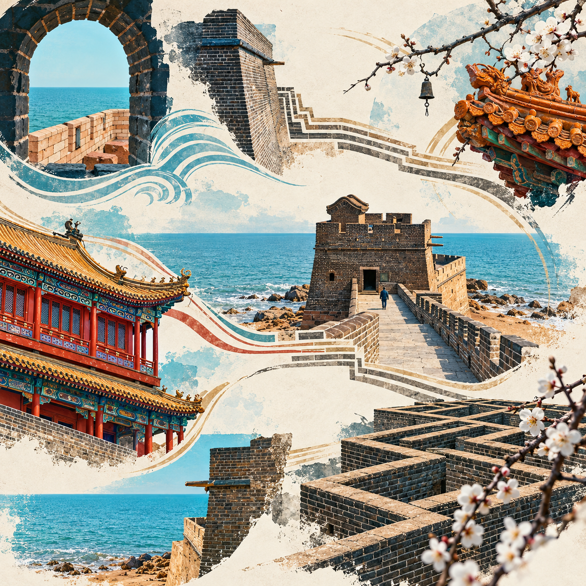
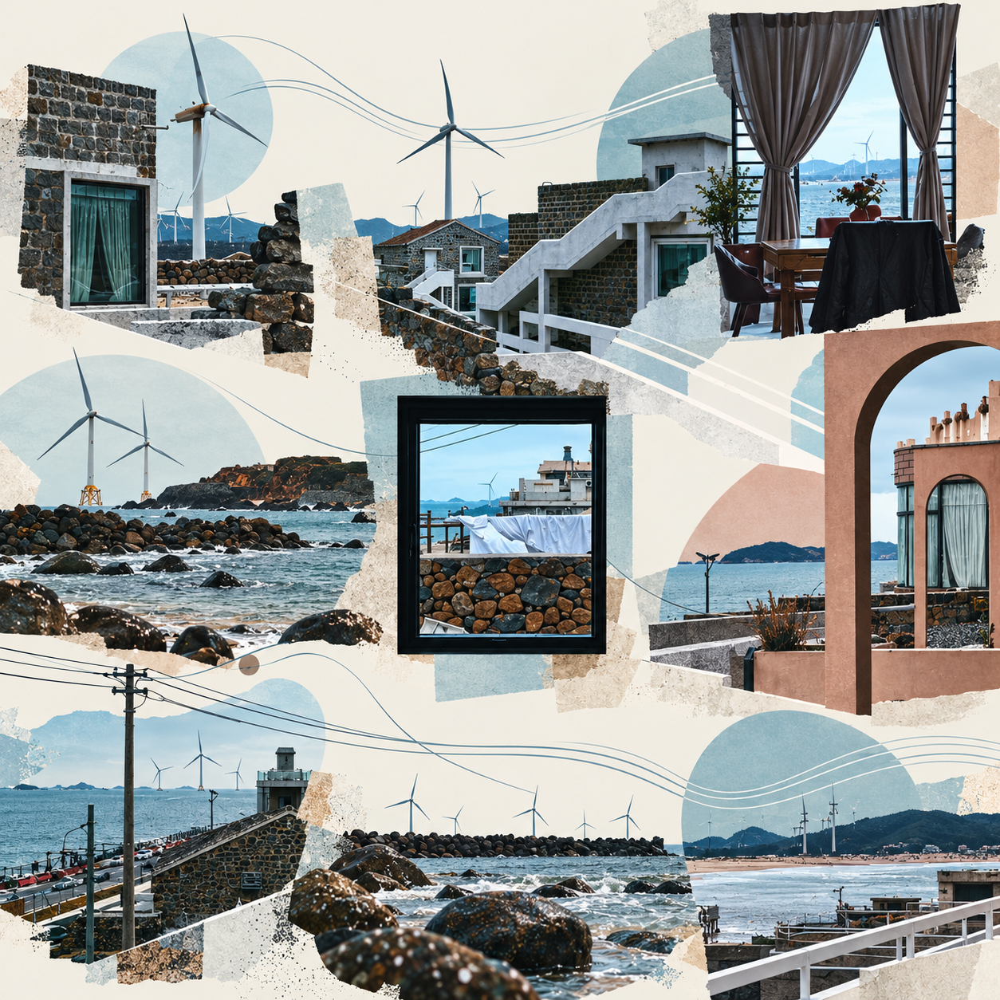
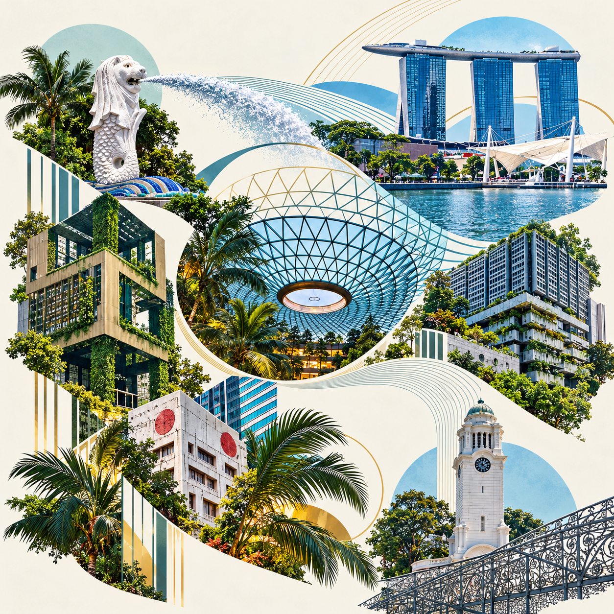

# 照片艺术拼贴九宫格

**把一组照片，变成一张可以连续阅读的艺术作品。**

适用于 Codex 的照片创作 Skill。上传旅行、城市漫步或生活记录照片，描述你想要的氛围，即可让 AI 从照片中提取主体，安排留白、统一色调，并通过源自素材的线条与图案串联画面。你可以选择一张完整母图，也可以导出适合朋友圈发布的九张切片。

## 作品示意

以下是使用该 Skill 创作的示例母图，展示不同素材与风格的可能性。实际效果随照片、要求和图像模型而变化。

| 山海关 · 建筑与海浪 | 平潭 · 海岛与几何 | 新加坡 · 城市与绿意 |
| --- | --- | --- |
|  |  |  |

## 你可以用它做什么

- **旅行回忆**：将沿途的建筑、风景与细节放进同一张有节奏的画面。
- **城市与生活记录**：让不同时间、不同视角的照片形成视觉联系。
- **社交分享**：先设计完整作品，再精确切成九张，兼顾合看与逐张浏览。

创作时会优先保留照片中的识别特征，控制主体大小和画面密度，让九格有内容、有变化，也有停顿。风格可按你的偏好选择，例如摄影蒙太奇、复古拼贴或实验性编辑设计。

## 开始使用

需要支持 Skill、能够读取图片且具备参考图生成或编辑能力的 Codex 环境。生成图片使用宿主提供的图像工具，可能产生相应使用费用；本仓库不包含独立的图像生成服务。

1. 下载本仓库，或运行：

   ```bash
   git clone https://github.com/KonkHsu/photo-collage-nine-grid.git
   ```

2. 将整个 `photo-collage-nine-grid` 文件夹放入 `~/.codex/skills/`，保留其中的目录结构。随后按宿主要求重新加载技能或开启新会话。
3. 上传照片，调用 `$photo-collage-nine-grid` 并说明主题、氛围和交付方式。

可以直接这样说：

> 用 $photo-collage-nine-grid，把这些旅行照片做成一张艺术拼贴。希望有清楚的留白、温暖的色调，照片之间有自然的视觉联系。只交完整母图，不分割。

> 用 $photo-collage-nine-grid，把这些城市照片做成连续叙事九宫格。先完成母图，再导出九张切片、间隔预览和 ZIP。

如需准确保留人脸、建筑结构或文字，请在开始时说明。生成模型可能改变细节；严格保真需要原图分割与合成的工作方式。

## 交付内容

| 选择 | 你会得到 |
| --- | --- |
| 仅母图 | 一张完整的正方形艺术拼贴图 |
| 母图 + 九宫格 | 完整母图、`01.png`–`09.png`、带间隔预览、顺序说明、尺寸记录与 ZIP |

切片编号从左到右、从上到下，发布时依次选择 `01`–`09`。Skill 不会代你发布到社交平台。

## 已有母图？直接切成九张

切图脚本可以独立使用，需要 Python 3.10+。在仓库目录运行：

```bash
python3 -m pip install -r requirements.txt
python3 scripts/split_grid.py final.png --output delivery
```

默认要求母图为正方形，边长可被 3 整除，输出目录不存在或为空。需要每张 1080 × 1080 时：

```bash
python3 scripts/split_grid.py final.png --output delivery --tile-size 1080
```

指定尺寸会按需插值缩放，放大不会增加原图真实细节。非正方形图片需明确选择 `--fit crop` 居中裁切或 `--fit pad` 补边。脚本负责精确切图与打包，创作与画面判断由 Skill 配合图像工具完成。

## 照片与隐私

请使用你有权处理的照片，并在上传前检查人脸、车牌、证件和住址等内容。图像生成会使用宿主提供的服务，照片处理方式以该服务为准。本地切图脚本不联网，导出的图片不复制源照片的 EXIF、GPS 等元数据；画面中可见的信息仍需自行检查。

仓库展示的是经过筛选的成果图，不包含原始照片、聊天截图或创作工作记录。示例用于说明效果，使用 Skill 创作时请提供自己的素材。
